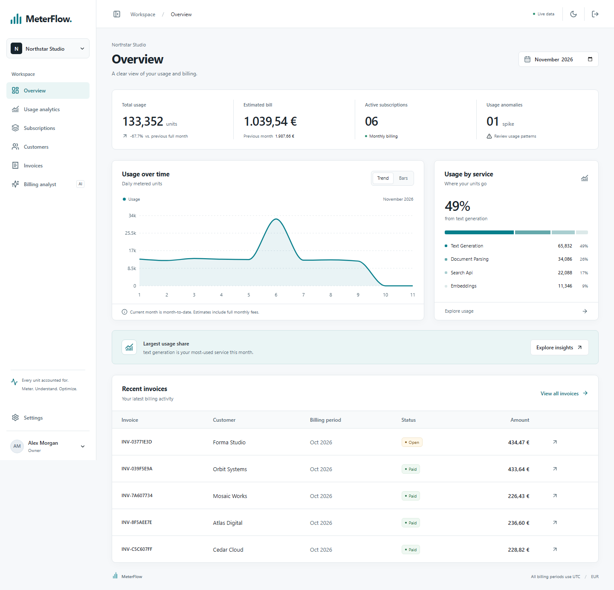

# MeterFlow

**Intelligent Usage & Billing Platform** — a Java 21 / Spring Boot portfolio application with a Next.js dashboard.

MeterFlow records tenant-scoped usage, calculates graduated EUR charges, closes calendar-month billing periods, and explains costs through deterministic analytics and an optional constrained AI analyst.



For reviewers: [five-minute demo](docs/portfolio.md) · [architecture](docs/architecture.md) · [test evidence](docs/verification.md).

## Run with Docker

Requires Docker Compose v2 and approximately 4 GB of available memory. No AI key is needed.

1. Copy `.env.example` to `.env`.
2. Replace `DATABASE_PASSWORD`, `JWT_SECRET` and `DEMO_PASSWORD` with unique values. JWT secret must contain at least 32 bytes; demo password at least 12 characters. For example, generate each secret using `openssl rand -hex 32`.
3. Run:

```sh
docker compose up --build -d
docker compose logs -f backend
```

Open **http://localhost:3000**. Sign in as `demo@meterflow.test` using the password you set in `.env`, or register a new organization.

- Backend: http://localhost:8080
- Swagger: http://localhost:8080/swagger-ui/index.html
- OpenAPI JSON: http://localhost:8080/v3/api-docs
- Health: http://localhost:8080/actuator/health
- PostgreSQL host port: **55432**, to avoid collisions with a local PostgreSQL installation.

The seed contains only synthetic names and usage: six customers, two plans, four services, and three completed billing months. Seeding runs once. Changing `DEMO_PASSWORD` does not overwrite an existing user's password.

If port 3000 is occupied, set `FRONTEND_PORT=3001` and `APP_ORIGIN=http://localhost:3001` in `.env`, then run `docker compose up -d --build --wait`. `localhost` and `127.0.0.1` are different origins. This checkout uses **http://localhost:3001** for the Docker frontend. All four services have health checks and restart unless explicitly stopped.

## Develop locally

Requires Java 21, Node 20.9+ (Node 22 recommended), and Docker for PostgreSQL/Redis and integration tests. The Maven wrapper downloads pinned Maven 3.9.11 on first use.

```sh
docker compose up -d postgres redis
# Export the variables from .env into your shell before starting Spring Boot.
cd backend
./mvnw spring-boot:run
```

In a second terminal:

```sh
cd frontend
npm ci
npm run dev
```

On Windows, use `mvnw.cmd` instead of `./mvnw`. `scripts/start-backend.ps1` loads `.env` and runs the packaged JAR. A project-local JDK under `.tools/jdk-21*` is detected if present; it is not committed. Build with `backend/mvnw.cmd -f backend/pom.xml package` first. Stop a running JAR before replacing it on Windows.

## Features

- Registration, BCrypt passwords, short-lived JWTs, rotating HttpOnly refresh cookies, database-checked session revocation.
- Organization roles, server-side membership checks, tenant-aware database relationships, hashed API keys.
- Validated ingestion, PostgreSQL uniqueness, conflict detection on changed replays, atomic Redis limits, concurrent retry protection.
- Immutable plans, graduated tiers, customer subscriptions, cancellation/history, UTC monthly billing.
- Transactional invoice snapshots, retry-safe hourly catch-up jobs, invoice details, PDF downloads and manual payment-status recording.
- Usage chart, service breakdown, monthly comparison, anomaly heuristic, customer search, pagination and CSV export.
- Profile editing, personal-data export/deletion, ownership safeguards and bounded retention cleanup.
- Opt-in AI using the official OpenAI Java SDK with Groq's compatible endpoint. It receives verified evidence and aggregate values; no SQL or write operations are exposed. Malformed output, unknown evidence IDs and unrecognized numeric values fall back to deterministic analytics.
- Responsive light/dark interface, keyboard-accessible forms and dialogs, loading/error/empty states.

## Engineering decisions worth discussing

**Concurrent ingestion and billing:** both lock the subscription row. `(organization_id, idempotency_key)` uniquely identifies an event. An identical retry returns its original receipt; a changed payload gets HTTP 409. An invoice uniquely identifies `(subscription_id, period_start)`. Events cannot enter a period after it closes.

**Financial determinism:** all prices and calculations use `BigDecimal`. Rates have up to six decimals; each invoice line rounds HALF_UP to two decimals. Invoice totals sum those rounded lines. Currency is explicitly EUR. Browser chart arithmetic is never used to issue invoices.

**JPA plus targeted SQL:** Spring Data JPA owns subscription locking/versioning. Parameterized JDBC queries handle conflict-aware inserts, aggregate reads and immutable invoice writes within the same Spring transaction. This avoids loading event collections just to calculate totals.

**Privacy boundary:** the analyst receives numeric aggregates, fixed intent categories and controlled evidence text. Raw questions, customer/service names, credentials and account identifiers never leave the application. The model selects and orders evidence; the UI displays server-owned facts, never untrusted model prose. No chat history is stored.

## Verification

```sh
cd backend
./mvnw verify spotless:check
cd ../frontend
npm ci
npm run format:check
npm run typecheck
npm run build
npx playwright install chromium
# App must be running, with DEMO_SEED=true and .env matching its demo password.
E2E_BASE_URL=http://localhost:3000 npm test
```

PowerShell: set `$env:E2E_BASE_URL='http://localhost:3000'` before `npm test`.

Tests use real PostgreSQL and Redis containers. Docker is required; unavailable Docker fails the tests rather than skipping them. SDK transport tests use a local HTTP server and never contact a live AI provider. Browser tests run against the actual backend and create/delete synthetic test identities.

ArchUnit checks controller/persistence boundaries and keeps pricing and the AI provider isolated from inappropriate dependencies. JaCoCo generates `backend/target/site/jacoco/index.html`; CI uploads coverage and test reports. See the [five-minute demo and CV guide](docs/portfolio.md) for a concise walkthrough and interview topics.

See [verification notes](docs/verification.md) for the checks actually run, [architecture](docs/architecture.md), [API examples](docs/api.md), [privacy/security](docs/security.md), and [operations](docs/operations.md).

## Deliberate boundaries

This is a production-style portfolio system, not a legally certified billing or payment service. It supports **EUR and UTC calendar-month billing only**, without proration, tax calculation, payment collection, credit notes or plan changes on existing subscriptions. Cancel and create a new subscription to use a different immutable plan; both can incur a base fee in that month.

Usage accepts at most 62 days of backfill while a subscription is active. Closing a month rejects late arrivals. Current-month comparisons use month-to-date against the previous full month and are labelled accordingly. Raw-data retention affects historical usage charts, while invoice totals remain preserved.

Email verification, password reset, MFA, billing-address/tax requirements, distributed backup automation, key rotation orchestration and an independently reviewed production security posture are outside this version. No GDPR-compliance claim is made. Review deployment, retention and provider terms before processing real data.
