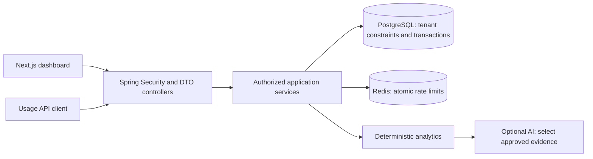

# MeterFlow architecture

Status: portfolio implementation running in Docker. Verified scope and remaining
product limits are recorded in README and docs/verification.md.

Java 21 / Spring Boot modular monolith, PostgreSQL as the source of truth,
Redis for atomic rate limits, and a Next.js browser client. Modules own controllers,
services and repositories. DTOs cross the HTTP boundary; entities never do.

## Data model

### Concurrency decision

Both event ingestion and invoice generation lock the same subscription row for the
duration of their transaction. If ingestion wins, billing includes its committed event.
If billing wins, subsequent ingestion sees the closed period and returns 409. This
trades per-subscription throughput for a small, explainable consistency boundary.
Database uniqueness protects retries even when requests arrive concurrently.

Refresh rotation uses a separate session-row lock. Previously used token digests
allow reuse detection; the revocation transaction commits despite its HTTP 401 result.
The integration suite exercises this through the HTTP boundary and then verifies that
an existing JWT is rejected. No raw refresh tokens are retained in history.

Users have many organization memberships (OWNER, ADMIN, VIEWER). Refresh sessions
belong to users. API keys belong to organizations and are stored as SHA-256 digests.
Organizations own customers, immutable plans and graduated tiers, subscriptions,
usage events and invoices. Composite foreign keys include organization_id so a
cross-tenant association also fails at the database boundary.

Usage event uniqueness: (organization_id, idempotency_key). Replays with different
payloads return conflict. Ingestion and billing serialize on the subscription row.
Billing closes UTC calendar months, recording immutable invoice lines and a unique
(subscription_id, period_start). Closed periods reject late events; callers must
submit corrections through a future credit-note workflow (not implemented).

Money: EUR only initially, numeric(19,6) unit rates, integer units, BigDecimal
arithmetic, HALF_UP rounding per invoice line to two decimal places. No tax engine,
payment collection, foreign exchange or legally certified invoicing is claimed.

JWTs are short-lived and authenticated with Spring Security's Nimbus implementation.
Every user request also checks an active database session; logout revokes access
immediately. Refresh tokens rotate under a row lock. Browser access tokens live in
memory; refresh tokens use HttpOnly SameSite cookies and Origin checks.

All user-facing resource queries include an authorized organization. API-key
ingestion derives tenant identity from the key, never the request payload.
Redis limits fail closed when unavailable. Health responses expose no details.

AI is opt-in and disabled without credentials. It receives aggregated facts from
authorized read-only services. No database tools, secrets, customer identifiers or
raw prompts are logged. Financial values are computed in Java. Model prose is
untrusted and cannot alter billing.

## Milestones

1. Foundation: schema, contracts, pricing algorithm and tests.
2. Identity: registration, login, refresh, revocation, membership and privacy.
3. Metering: API keys, limits, idempotency, concurrent PostgreSQL tests.
4. Billing: month closure, scheduled retries, invoice snapshots and PDF.
5. Product UI: design tokens, all workflows, responsive light/dark dashboard.
6. Analytics and opt-in AI, with deterministic fallback.
7. Verification: integration/security tests, builds, CI and operations guidance.

## Design system

Canvas #f6f8fa; surface #ffffff; text #18252d; muted #53646f;
border #dce3e8; accent #087f8c. Dark mode uses #10191f and #18252d surfaces.
Segoe UI/system sans supports readable operational screens; figures use tabular
numerals. Spacing: 4, 8, 12, 16, 24, 32px. Controls: 6px radius, panels: 10px.
Left-aligned headings, compact tables, visible focus, explicit form labels.

Layout: navigation rail | page heading and date range | usage chart and service
breakdown | invoice ledger. The characteristic element is a segmented meter mark
paired with a usage-versus-cost chart. Avoid decorative marketing sections and
repeated KPI cards; use a single aligned metric strip.

Plan review: the initial generic card grid was rejected in favor of a chart/ledger
workspace. UI text is limited to labels, actionable errors and necessary privacy
disclosures. No display serif, gradients or ornamental animation.
